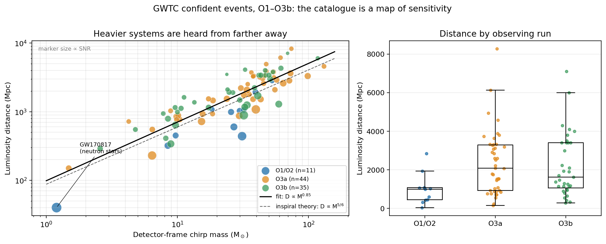

# Heard, not counted: selection bias in the gravitational-wave catalogue

**Question:** Does the distribution of black-hole and neutron-star mergers in the LIGO–Virgo–KAGRA catalogue describe the universe, or the detectors?



## Data
- **Source:** [GWOSC Event Portal](https://gwosc.org/eventapi/), cumulative GWTC release (GWTC-1, GWTC-2.1, GWTC-3), covering observing runs O1–O3b.
- **Selection:** 90 *confident* events (marginal and auxiliary candidates dropped). Median posterior values only; uncertainties are not propagated.
- **Not included:** O4 events (later GWTC releases).
- **Columns:** `data/gwtc_confident.csv` holds component masses, SNR, luminosity distance, χ_eff, source-frame chirp mass and redshift.
- Detector-frame chirp mass is computed as `Mc_src × (1 + z)`, since that is what the detector measures.

## Method
1. Plot luminosity distance against detector-frame chirp mass on log-log axes.
2. Fit `log D = a + b·log Mc` and bootstrap the slope (5,000 resamples).
3. Compare with the inspiral-phase expectation. At a fixed SNR threshold, the strain amplitude scales as `Mc^(5/3) / D`, and SNR scales as `Mc^(5/6) / D`. So **D_max ∝ Mc^(5/6)**, a slope of ≈ 0.83.
4. Compare median distance per observing run.

## Results
| Run | Events | Median distance (Mpc) | Median detector-frame Mc (M☉) |
|---|---|---|---|
| O1/O2 | 11 | 990 | 27.0 |
| O3a | 44 | 2080 | 37.3 |
| O3b | 35 | 1620 | 30.0 |

- Fitted slope: **0.85** (95% bootstrap CI 0.73–0.97). Theory predicts 0.83.
- Spearman ρ = 0.84 (p ≈ 10⁻²⁵), R² = 0.74.
- Restricted to Mc < 30 M☉, the inspiral-dominated regime, the slope is 0.84.

## Conclusion
**Heavier mergers appear farther away, with a scaling consistent with detector physics (D ∝ Mc^5/6).** Raw catalogue counts are therefore a map of detector sensitivity. Using them to infer the true merger population requires modelling the selection effect first. The catalogue is not a fair sample of the universe.

## Caveats
- Distances are posterior medians with wide errors, especially for faint events. The fit treats them as exact.
- The slope CI is bootstrapped over events and ignores measurement uncertainty.
- O3b's median distance is lower than O3a's. Run-level differences also depend on the mass mix, so I don't read them as detector performance. A proper comparison needs the injection-based sensitivity estimates released by the LVK.
- The data was transcribed from the GWOSC event table. Verify against the source before citing numbers.

## Reproduce
```bash
pip install pandas numpy scipy matplotlib
python analyze.py   # prints the summary and writes figure.png
```

## Data credit
Gravitational-wave data and catalogues are from the LIGO Scientific Collaboration, Virgo Collaboration and KAGRA Collaboration, via the Gravitational Wave Open Science Center (gwosc.org).
